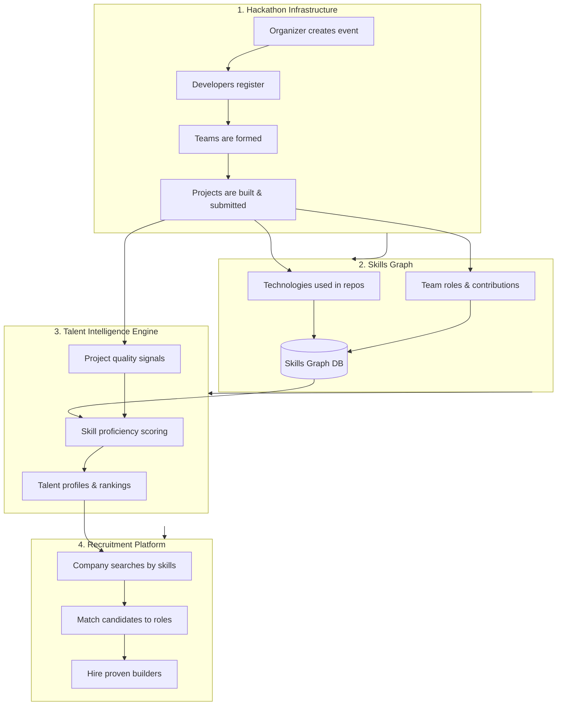

# Soufo Backend

REST API for **[Soufo](https://github.com/tiagofoks/soufo_front)** — a platform that combines **Hackathon Infrastructure**, **Talent Intelligence**, **Skills Graph**, and **Recruitment** into a single ecosystem for discovering, developing, and hiring technical talent.

| Repository | Role | URL |
|---|---|---|
| **soufo_backend** (this repo) | REST API, business logic, database | `git@github.com:tiagofoks/soufo_backend.git` |
| **soufo_front** | Web UI (Angular) | `git@github.com:tiagofoks/soufo_front.git` |

---

## Table of Contents

- [What is Soufo?](#what-is-soufo)
- [How the Platform Works](#how-the-platform-works)
- [Architecture Overview](#architecture-overview)
- [Tech Stack](#tech-stack)
- [Prerequisites](#prerequisites)
- [Getting Started — Backend](#getting-started--backend)
- [Getting Started — Frontend](#getting-started--frontend)
- [Running the Full Stack Locally](#running-the-full-stack-locally)
- [API Reference](#api-reference)
- [Database Schema](#database-schema)
- [Project Structure](#project-structure)
- [Running Tests](#running-tests)
- [Configuration](#configuration)
- [Roadmap](#roadmap)
- [Contributing](#contributing)

---

## What is Soufo?

Soufo is a talent platform built around a simple idea: **the best way to evaluate developers is to watch them build under real conditions**.

Instead of relying only on résumés and interviews, Soufo uses hackathons and project delivery as the primary signal. Every event, team, and submission becomes structured data that feeds a **Skills Graph** and a **Talent Intelligence Engine** — which in turn powers a **Recruitment Platform** for companies looking to hire proven builders.

Soufo serves four audiences:

| Audience | What they get |
|---|---|
| **Developers** | Join hackathons, form teams, ship projects, and build a verifiable skills profile |
| **Organizers** | Create and manage hackathon events, teams, and project submissions |
| **Companies / Recruiters** | Discover talent based on demonstrated skills, not self-reported claims |
| **Judges / Mentors** | Evaluate projects and contribute to talent scoring |

---

## How the Platform Works

Soufo operates as four interconnected layers. Each layer produces data that feeds the next.



### 1. Hackathon Infrastructure

The operational core of Soufo. Organizers publish events; developers register, join or create teams, and submit projects. The backend manages the full lifecycle:

- Event creation with dates, location, and status (`PLANNING → OPEN → IN_PROGRESS → CLOSED → ARCHIVED`)
- Team formation (join existing team or create a new one on registration)
- Project tracking (`IDEA → IN_DEVELOPMENT → SUBMITTED → JUDGING → COMPLETED`)
- Role-based access (`ADMIN`, `USER`, `ORGANIZER`, `JUDGE`)

### 2. Skills Graph

A structured map of **who knows what**, built automatically from hackathon activity:

- Technologies detected in project repositories
- Roles played on teams (leader, contributor, specialist)
- Skill domains inferred from project categories and deliverables
- Relationships between people, skills, and projects over time

The graph grows with every event — it is not a static profile users fill in manually.

### 3. Talent Intelligence Engine

An analytics layer that turns raw hackathon data into actionable talent signals:

- **Performance scoring** — project completion, code quality, team collaboration
- **Skill verification** — skills backed by shipped work, not checkbox lists
- **Trend analysis** — emerging skills, growth trajectories, consistency over events
- **Ranking & discovery** — surface top performers by skill domain, location, or event type

### 4. Recruitment Platform

The commercial layer that connects verified talent with hiring companies:

- Search candidates by verified skills from the Skills Graph
- View hackathon history, projects, and team contributions
- Match job requirements to talent profiles with confidence scores
- Shortlist and contact builders who have already proven they can deliver

---

## Architecture Overview

```
┌─────────────────────────────────────────────────────────┐
│                    soufo_front (Angular)                 │
│                   http://localhost:4200                  │
└──────────────────────────┬──────────────────────────────┘
                           │ HTTP / REST (CORS enabled)
                           ▼
┌─────────────────────────────────────────────────────────┐
│              soufo_backend (Spring Boot)                 │
│                   http://localhost:8080/api              │
│                                                          │
│  ┌─────────────┐  ┌──────────────┐  ┌────────────────┐  │
│  │ Auth Module │  │  Hackathon   │  │  Future:       │  │
│  │             │  │  Module      │  │  Skills Graph  │  │
│  │ register    │  │              │  │  Talent Engine │  │
│  │ login       │  │ list/create  │  │  Recruitment   │  │
│  └─────────────┘  │ register     │  └────────────────┘  │
│                   └──────────────┘                       │
└──────────────────────────┬──────────────────────────────┘
                           │ JDBC
                           ▼
┌─────────────────────────────────────────────────────────┐
│                   MySQL (soufo_db)                       │
│         users · roles · hackathons · teams · projects   │
└─────────────────────────────────────────────────────────┘
```

---

## Tech Stack

| Layer | Technology |
|---|---|
| Language | Java 17 |
| Framework | Spring Boot 4.0.6 |
| Security | Spring Security (BCrypt password hashing) |
| Persistence | Spring Data JPA + Hibernate |
| Database | MySQL 8.x |
| Build tool | Apache Maven 3.8+ |
| Frontend (separate repo) | Angular — [soufo_front](git@github.com:tiagofoks/soufo_front.git) |

---

## Prerequisites

Install the following before setting up the project:

| Tool | Minimum version | Verify |
|---|---|---|
| **Java JDK** | 17 | `java -version` |
| **Apache Maven** | 3.8 | `mvn -version` |
| **MySQL Server** | 8.0 | `mysql --version` |
| **Git** | any recent | `git --version` |
| **Node.js** *(frontend only)* | 18+ | `node -v` |
| **npm** *(frontend only)* | 9+ | `npm -v` |

---

## Getting Started — Backend

### Step 1 — Clone the repository

```bash
git clone git@github.com:tiagofoks/soufo_backend.git
cd soufo_backend
```

> **HTTPS alternative:** `git clone https://github.com/tiagofoks/soufo_backend.git`

### Step 2 — Create the MySQL database and user

Open a MySQL shell (`mysql -u root -p`) and run:

```sql
CREATE DATABASE IF NOT EXISTS soufo_db
  CHARACTER SET utf8mb4
  COLLATE utf8mb4_unicode_ci;

CREATE USER IF NOT EXISTS 'soufo_db'@'localhost' IDENTIFIED BY 'H0m3r$1mp$0n';
GRANT ALL PRIVILEGES ON soufo_db.* TO 'soufo_db'@'localhost';
FLUSH PRIVILEGES;
```

> Change the password in production. For local development, the default credentials match `application.properties`.

### Step 3 — Review configuration

Database and server settings live in `src/main/resources/application.properties`:

```properties
spring.datasource.url=jdbc:mysql://localhost:3306/soufo_db?useSSL=false&serverTimezone=UTC
spring.datasource.username=soufo_db
spring.datasource.password=H0m3r$1mp$0n
server.servlet.context-path=/api
server.port=8080
```

On first startup, Spring Boot will:

1. Run `schema.sql` to create tables (if they do not exist)
2. Run `data.sql` to seed default roles (`ADMIN`, `USER`, `ORGANIZER`, `JUDGE`)
3. Let Hibernate apply any entity-level schema updates (`ddl-auto=update`)
4. Execute database triggers from `triggers.sql` via `DatabaseInitializer`

### Step 4 — Install dependencies

Maven downloads all libraries automatically on the first build. No manual JAR installation is needed.

```bash
mvn clean install -DskipTests
```

This resolves and installs:

- `spring-boot-starter-web`
- `spring-boot-starter-security`
- `spring-boot-starter-data-jpa`
- `mysql-connector-j`
- `jackson-databind`
- Test dependencies (`spring-boot-starter-test`, `spring-boot-webmvc-test`)

### Step 5 — Run the API

```bash
mvn spring-boot:run
```

Or run the packaged JAR:

```bash
java -jar target/soufo-backend-0.0.1-SNAPSHOT.jar
```

The API starts at **http://localhost:8080/api**.

Verify it is running:

```bash
curl http://localhost:8080/api/hackathons
```

Expected response: `[]` (empty array until hackathons are created).

---

## Getting Started — Frontend

The Angular frontend lives in a separate repository and connects to this backend over REST.

### Step 1 — Clone the frontend

```bash
git clone git@github.com:tiagofoks/soufo_front.git
cd soufo_front
```

### Step 2 — Install Node dependencies

```bash
npm install
```

### Step 3 — Start the development server

```bash
npm start
# or
ng serve
```

The UI runs at **http://localhost:4200** and is pre-configured to call the backend at `http://localhost:8080/api`.

> CORS is enabled in the backend for `http://localhost:4200`. If you change the frontend port, update `SecurityConfig.java` and the `@CrossOrigin` annotations on controllers.

---

## Running the Full Stack Locally

Open two terminal windows:

**Terminal 1 — Backend**

```bash
cd soufo_backend
mvn spring-boot:run
```

**Terminal 2 — Frontend**

```bash
cd soufo_front
npm start
```

| Service | URL |
|---|---|
| Frontend (Angular) | http://localhost:4200 |
| Backend API | http://localhost:8080/api |
| MySQL | localhost:3306 / `soufo_db` |

### Quick smoke test

```bash
# 1. Register a user
curl -X POST http://localhost:8080/api/auth/register \
  -H "Content-Type: application/json" \
  -d '{"email":"dev@example.com","password":"secret123","firstName":"Ana","lastName":"Silva"}'

# 2. Create a hackathon
curl -X POST http://localhost:8080/api/hackathons \
  -H "Content-Type: application/json" \
  -d '{"title":"Soufo Hack 2026","description":"Build the future","startDateTime":"2026-07-01T09:00:00","endDateTime":"2026-07-03T18:00:00","location":"São Paulo"}'

# 3. Register for the hackathon (use the returned hackathon id)
curl -X POST http://localhost:8080/api/hackathons/1/register \
  -H "Content-Type: application/json" \
  -d '{"email":"dev@example.com","teamName":"Team Alpha"}'

# 4. List all hackathons
curl http://localhost:8080/api/hackathons
```

---

## API Reference

Base URL: `http://localhost:8080/api`

### Authentication

| Method | Endpoint | Description |
|---|---|---|
| `POST` | `/auth/register` | Create a new user account |
| `POST` | `/auth/login` | Authenticate and receive a token |

**Register request body:**

```json
{
  "email": "user@example.com",
  "password": "yourpassword",
  "firstName": "First",
  "lastName": "Last"
}
```

**Auth response:**

```json
{
  "token": "token-<uuid>",
  "email": "user@example.com",
  "firstName": "First",
  "lastName": "Last"
}
```

### Hackathons

| Method | Endpoint | Description |
|---|---|---|
| `GET` | `/hackathons` | List all hackathons |
| `POST` | `/hackathons` | Create a new hackathon |
| `POST` | `/hackathons/{id}/register` | Register a user for a hackathon (join or create team) |

**Create hackathon request body:**

```json
{
  "title": "Soufo Hack 2026",
  "description": "48-hour innovation sprint",
  "startDateTime": "2026-07-01T09:00:00",
  "endDateTime": "2026-07-03T18:00:00",
  "location": "São Paulo, BR",
  "organizerId": 1
}
```

**Registration request body:**

```json
{
  "email": "user@example.com",
  "teamName": "Team Alpha"
}
```

Or join an existing team by ID:

```json
{
  "email": "user@example.com",
  "teamId": 1
}
```

---

## Database Schema

| Table | Purpose |
|---|---|
| `users` | Platform accounts (email, password, name) |
| `roles` | Access roles: `ADMIN`, `USER`, `ORGANIZER`, `JUDGE` |
| `user_roles` | Many-to-many user ↔ role assignments |
| `hackathons` | Events with lifecycle status |
| `teams` | Teams scoped to a hackathon |
| `team_members` | Many-to-many team ↔ user membership |
| `projects` | Team submissions with repository URL and status |
| `audit_log` | Change tracking for users and hackathons |

Hackathon status flow: `PLANNING → OPEN → IN_PROGRESS → CLOSED → ARCHIVED`

Project status flow: `IDEA → IN_DEVELOPMENT → SUBMITTED → JUDGING → COMPLETED`

---

## Project Structure

```
soufo_backend/
├── pom.xml                          # Maven dependencies and build config
├── src/
│   ├── main/
│   │   ├── java/com/soufo/api/
│   │   │   ├── SoufoApiApplication.java
│   │   │   ├── config/
│   │   │   │   ├── DatabaseInitializer.java   # Runs triggers on startup
│   │   │   │   └── SecurityConfig.java          # CORS, BCrypt, auth rules
│   │   │   ├── controller/
│   │   │   │   ├── AuthController.java
│   │   │   │   └── HackathonController.java
│   │   │   ├── dto/                             # Request/response objects
│   │   │   ├── model/                           # JPA entities
│   │   │   ├── repository/                      # Spring Data repositories
│   │   │   └── service/                         # Business logic
│   │   └── resources/
│   │       ├── application.properties
│   │       ├── schema.sql                       # DDL — table creation
│   │       ├── data.sql                         # Seed data (roles)
│   │       └── triggers.sql                     # Audit & timestamp triggers
│   └── test/
│       └── java/com/soufo/api/                  # Unit & integration tests
└── README.md
```

---

## Running Tests

```bash
# Run all tests
mvn test

# Run a specific test class
mvn test -Dtest=HackathonServiceTest

# Run tests with verbose output
mvn test -X
```

Test coverage includes:

- `AuthControllerTest` — registration and login endpoints
- `HackathonServiceTest` — hackathon business logic
- `UserServiceTest` — authentication and user persistence

---

## Configuration

| Property | Default | Description |
|---|---|---|
| `server.port` | `8080` | HTTP port |
| `server.servlet.context-path` | `/api` | API base path |
| `spring.datasource.url` | `jdbc:mysql://localhost:3306/soufo_db` | MySQL connection |
| `spring.jpa.hibernate.ddl-auto` | `update` | Auto-sync entity schema |
| `spring.sql.init.mode` | `always` | Run schema.sql and data.sql on startup |
| CORS allowed origin | `http://localhost:4200` | Frontend dev server |

To override settings without editing files, pass JVM arguments:

```bash
mvn spring-boot:run \
  -Dspring-boot.run.arguments="--spring.datasource.password=NEW_PASSWORD --server.port=9090"
```

---

## Roadmap

The current backend implements the **Hackathon Infrastructure** layer. Planned modules:

| Module | Status | Description |
|---|---|---|
| Hackathon Infrastructure | **Implemented** | Events, teams, registration, projects schema |
| User Authentication | **Implemented** | Register, login, BCrypt hashing |
| Skills Graph | Planned | Auto-extract skills from repos and team activity |
| Talent Intelligence Engine | Planned | Scoring, rankings, skill verification |
| Recruitment Platform | Planned | Company search, candidate matching, hiring pipeline |
| JWT Authentication | Planned | Replace placeholder tokens with signed JWTs |
| Role-based Authorization | Planned | Enforce `ORGANIZER`, `JUDGE`, `ADMIN` permissions |

---

## Contributing

1. Fork the repository
2. Create a feature branch: `git checkout -b feature/my-feature`
3. Make your changes and add tests
4. Run `mvn test` to ensure nothing breaks
5. Commit and push: `git push origin feature/my-feature`
6. Open a Pull Request against `main`

---

## License

This project is part of the Soufo platform. See repository settings for license details.
